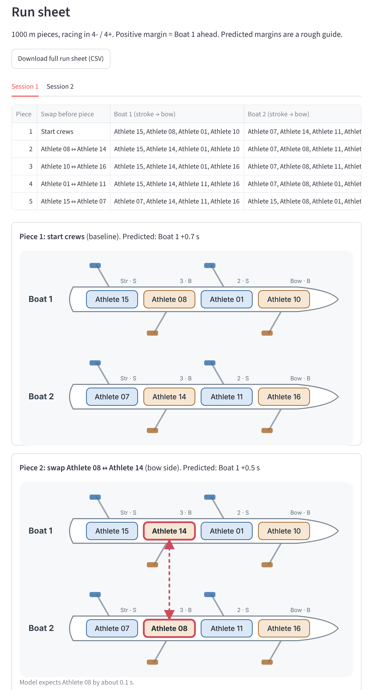

# Seat Racing

A crew selection tool I built for the University of Exeter Boat Club (about 300 members). It plans seat races, records results on the launch, and learns from every result how much each athlete really moves a boat compared with what their erg score predicts.

**Try the demo:** [link to the demo app] (made-up squad, so no real athlete data)



## The problem

Crew selection usually leans on erg scores plus a coach's eye for technique. Ergs miss technique and rhythm, and "technique scores" are guesses that vary from coach to coach. Seat racing measures both, but it's easy to run badly: unbalanced crews, predictable swaps, results lost in notebooks, and seats decided by one noisy piece.

## What it does

| Page | What it's for |
|---|---|
| **Squad** | Athletes, sides and best 2ks, plus the current order on the water |
| **Plan** | Picks who races, keeps the strokes fixed, builds even crews and chooses the swaps a coach would want (close calls, unanswered questions, seats on the line), with randomness so athletes can't predict them |
| **Enter Piece** | On the launch: record each piece's margin or both boats' times, straight from the saved plan |
| **Selection** | Who's in, how sure the evidence is, which results look wrong, and which pieces would settle the remaining seats (these feed back into the next plan) |
| **Results** | Every head-to-head, plus a direct-race check for any two athletes |
| **Learning** | What the model has learned: how much ergs explain, each athlete's boat-moving score, and each stroke's effect |

## How it works

- **Spotting swaps:** the app compares consecutive pieces and only counts a result when exactly one athlete has swapped, boats have kept their lanes, and the strokes haven't changed (or the two strokes have swapped boats, which measures stroking).
- **The seat race maths:** a swap changes both boats, so the athlete difference is half the change in margin.
- **The learning model:** each result is one equation, *on-water difference = erg weight × erg difference + boat-moving score A − boat-moving score B*. It's solved by regularised least squares (Bayesian ridge regression): every athlete starts at "as their erg predicts" and only moves away as results back it up, with a 95% range on every score. The noise level is measured from the data once there are enough results.
- **Testing it:** `simulate_season.py` makes a pretend season with hidden boat-moving scores. The model recovers them with a correlation of about 0.95 from 30 results.
- **Selection:** a seat is only called when the two athletes have raced directly, the margin is clear, and the overall evidence agrees.

## Run it yourself

```
pip install -r requirements.txt
python simulate_season.py      # optional: a pretend season for the Learning page
streamlit run app.py
```

Without any setup it runs on `sample_squad.csv`, a made-up squad, and saves to local files. The club version saves to a private Google Sheet: each squad signs in with its own password and only sees its own athletes and results, and nobody using the app can see the sheet itself. Real athlete data never goes on GitHub.

## What I learned

- Turning a coaching problem into rules a program can follow, and deciding where the program should refuse to decide.
- Python, pandas, NumPy and Streamlit, starting from close to zero.
- Building a model that is honest about uncertainty, and testing it on simulated data where the right answers are known.
- Building for real users: captains, a phone on a launch, and data that has to stay private.

Built with Python, pandas, NumPy, Streamlit and Google Sheets. I used Claude (AI) as a tutor and pair-programmer while learning; the design decisions are mine.
